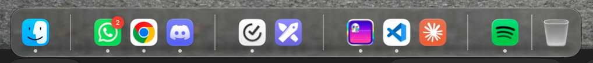
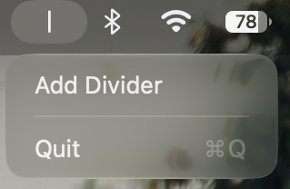

# Dock Divider

A tiny macOS menu bar app that turns the Dock's native spacers into thin divider lines, matching the one that separates apps from the Trash.



The dividers are regular Dock spacer tiles (no icon, no tooltip). Dock Divider reads where each spacer is through the Accessibility API and draws a line over it in a transparent, click-through window.

## Requirements

- macOS 14 or later
- The **Accessibility** permission. Dock Divider uses it only to read where the Dock's items are, so it can draw the lines over the spacers; it does not read your keyboard, screen, or data. The app asks for it on first launch: open **System Settings → Privacy & Security → Accessibility** (on newer macOS versions, the pane listing apps allowed to control your Mac) and turn on Dock Divider. If it is not in the list, click **+** and add it from `Applications`.

## Install

Paste this in Terminal:

```sh
curl -fsSL https://raw.githubusercontent.com/luantedesco/dock-divider/main/Tools/install.sh | sh
```

It downloads the latest release, installs it in `/Applications`, and opens it. Run it again to update.

### Manual install

Download `DockDivider.dmg` from the [latest release](https://github.com/luantedesco/dock-divider/releases/latest), open it, and drag `Dock Divider.app` to `Applications`.

The app is not notarized by Apple, so macOS blocks it on first launch. To open it:

- **macOS 15 or later:** try to open the app, then go to **System Settings → Privacy & Security** and click **Open Anyway**.
- **macOS 14:** right-click the app, choose **Open**, then confirm.

Or remove the quarantine flag from the terminal:

```sh
xattr -dr com.apple.quarantine "/Applications/Dock Divider.app"
```

## Usage



- **Add Divider** (menu bar icon): adds a spacer at the end of the apps section of the Dock. Drag it to where you want it.
- **Open at Login**: starts Dock Divider with your Mac, so the lines are always there.
- **Remove a divider**: drag the spacer out of the Dock, as with any Dock item.

Adding a divider writes to the Dock's preferences (`defaults write com.apple.dock persistent-apps`) and restarts the Dock (`killall Dock`). The spacers stay in the Dock even if Dock Divider is not running; they just show as empty space.

## Uninstall

1. Turn off **Open at Login** in the menu, then choose **Quit**.
2. Drag each spacer out of the Dock; otherwise they stay as empty gaps.
3. Move `Dock Divider.app` from `Applications` to the Trash.

## Build

```sh
./build.sh
```

The app is built at `build/Dock Divider.app` as a universal binary (Apple Silicon and Intel). Move it to `/Applications` and open it.

To package it as a disk image for distribution:

```sh
./Tools/make-dmg.sh
```

The image is created at `build/DockDivider.dmg`.

To run the tests:

```sh
./test.sh
```

The app icon is drawn in `Resources/icon.svg`. `build.sh` turns it into `AppIcon.icns` on every build, so editing the SVG and rebuilding is enough.

## Contributing

Bug reports, ideas, and pull requests are welcome. [CONTRIBUTING.md](CONTRIBUTING.md) covers building, testing, and the signing certificate that keeps the Accessibility permission across builds.

## Translations

Dock Divider is available in English and Brazilian Portuguese. To add a language, see [Translations](CONTRIBUTING.md#translations) in CONTRIBUTING.md.

## License

[MIT](LICENSE)
